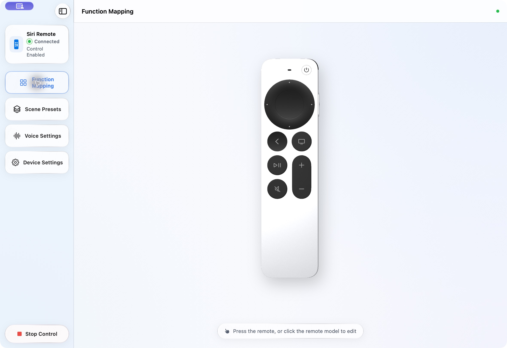
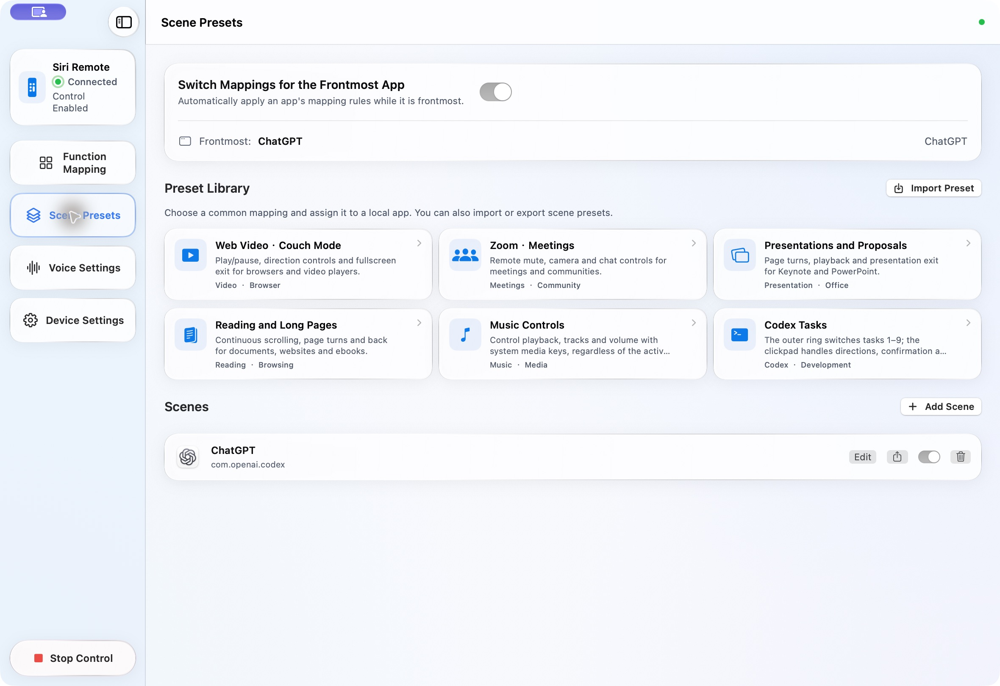
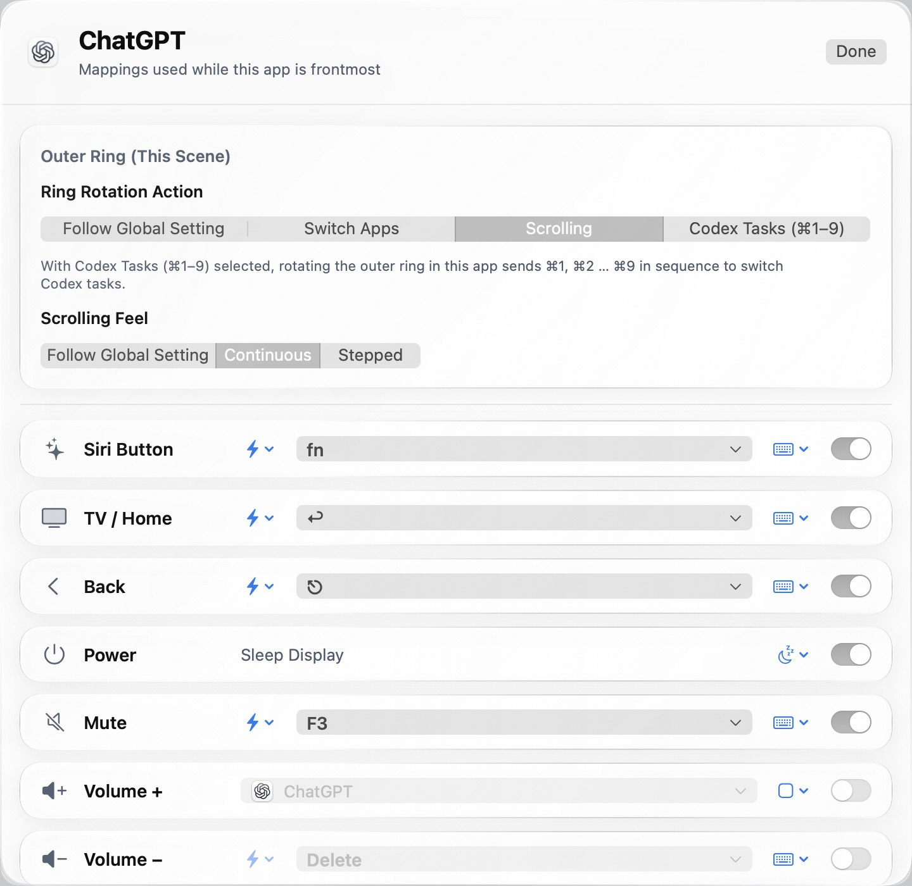
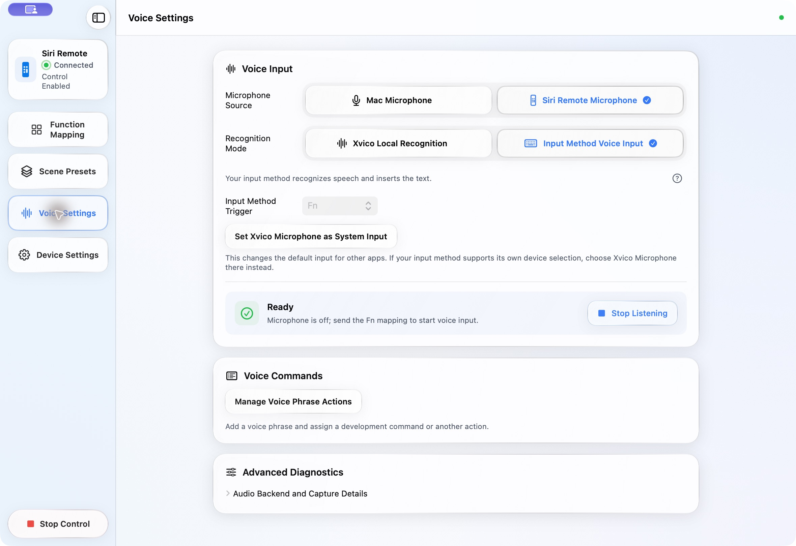
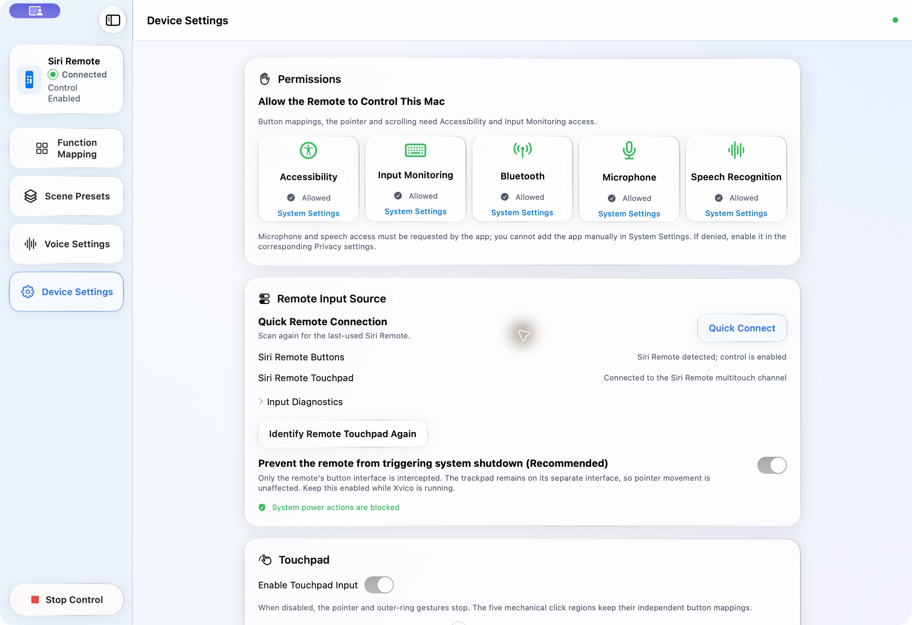

# Xvico

**A coding remote in the palm of your hand.**

[简体中文](README.md) · [English](README.en.md)

Xvico is a macOS companion for Siri Remote, with customizable controls and voice input. Move the pointer, scroll conversations and code, switch apps or tasks, and assign different button mappings to each app. For dictation, route audio from your Mac or Siri Remote to on-device recognition or your preferred input method.



## Features

| Feature | What it does |
| --- | --- |
| **3D function mapping** | Rotate the remote and click its buttons to edit their behavior. Configure single presses, double presses and holds. |
| **Per-app scenes** | Add an installed app and edit its mappings. Enabled scenes can follow the frontmost app; unmatched apps use the global mapping. |
| **Pointer and outer-ring controls** | Move the pointer with the touchpad. Use the outer ring for continuous or stepped scrolling, app switching, or ⌘1–9 task shortcuts. |
| **Editable presets** | Start with coding multitasking, reading, web video, presentation, meeting or music presets. Bind them to apps, customize them, and import or export scenes. |
| **Two voice paths** | Use macOS on-device recognition, or let an existing input method handle recognition and text insertion. Choose a Mac or Siri Remote microphone. |
| **System virtual microphone** | Optionally install Xvico Microphone so other apps can receive audio from the remote. |
| **Appearance and languages** | Light, dark and system appearance; Simplified Chinese, English, Japanese and French interfaces. |

## Screenshots

These are actual screenshots of the current Xvico interface. Click an image for the full-size view. The mappings shown are examples and can be edited.

| Scene presets | Per-app button editor |
| --- | --- |
| [](docs/screenshots/scenes-en.png) | [](docs/screenshots/scene-editor-en.png) |
| Start with a preset or add a scene for another installed app. | Edit the app's outer-ring behavior, button actions and shortcuts in one place. |

| Voice input | Devices and permissions |
| --- | --- |
| [](docs/screenshots/voice-en.png) | [](docs/screenshots/device-en.png) |
| Choose the audio source and recognition path, then match your input method's trigger. | Review permissions and connection status, and adjust remote input and touch behavior. |

[Chinese and English screenshot index](docs/screenshots/README.md)

## Getting started

1. Pair Siri Remote with your Mac in macOS Bluetooth settings, then open Xvico.
2. Check Accessibility and Input Monitoring in **Device Settings**. Grant the relevant Bluetooth and voice permissions when prompted by macOS.
3. In **Function Mapping**, click a button on the 3D remote to assign a shortcut, mouse click, text or another action. Configure single presses, double presses and holds as needed.
4. Choose an app under **Scene Presets → Add Scene**, or select a preset and assign it to an app. Edit and enable the scene, then enable switching for the frontmost app.
5. For voice input, choose a microphone source and recognition mode in **Voice Settings**, then complete the setup below.

Buttons and touch controls work without audio capture. A target app must support the shortcuts you assign: for example, the ⌘1–9 preset depends on matching task-switching shortcuts in that app.

## Voice input

| Mode | Recognition and output | Requirements |
| --- | --- | --- |
| **Xvico Local Recognition** | Uses the on-device macOS Speech recognizer and passes text to Xvico's text/action workflow. | Microphone and Speech Recognition access; an OS and recognition language that support on-device recognition, with the necessary local speech resources. |
| **Input Method Voice Input** | Your input method recognizes speech and inserts text into the focused field. | A voice-capable input method, with its trigger key matched by both Xvico's trigger setting and the actual remote button mapping. |

In input method mode, map your chosen remote button behavior to the input method's trigger key. For example, if it uses Fn, select Fn in Xvico and assign the desired single press, double press or hold to that key. Recognition start and stop behavior follows the input method's own shortcut rules.

To use the Siri Remote microphone:

- Supply the Apple capture runtime described below and approve the system audio backend through the administrator prompt.
- Select **Xvico Microphone** in your input method or target app. If it cannot select its own device, you can explicitly set it as the system input in Xvico; this changes the default input used by other apps.
- Choose **Save background approval** to approve helper installation once. Subsequent manual starts reuse approval, including after reopening the app. Installation and app launch never start capture. The original temporary, session-only approval remains available. Updating or removing the installed helper still requires an administrator.
- Capture uses temporary Bluetooth diagnostics, which may include other devices. Its scope is explained before persistent or temporary approval. A session lasts up to one hour; ordinary shutdown restores diagnostics. You can start another session after expiry without losing saved background approval.
- **Preset Scenes → Restore initial mappings** restores volume, mute, mouse click and other initial mappings, pausing saved scenes without deleting their configuration. The last restore can be undone after relaunch. Re-enable an app scene to resume automatic switching with the foreground app.

Local recognition requests on-device processing and does not fall back to an online recognition service. In input method mode, the selected input method determines the recognition service, network use and privacy policy. See [Security](SECURITY.md) for abnormal-termination considerations.

## Build from source

Requirements: **macOS 13 or later**, a compatible Xcode/Swift toolchain and macOS SDK, Python 3, and system build tools. The current button and touch implementation matches the Apple remote with product ID `0x0315`; other models require verification.

All Swift source modules are included in this project, with no sibling-project dependencies. From the repository root:

```sh
./build-app.sh
open dist/Xvico.app
```

The script builds the app, audio tools and virtual microphone driver, signs the bundle locally, and writes `dist/Xvico.app`. On the first build, it downloads a pinned Opus release from Xiph's official site, checks its SHA256, and compiles it. Later builds reuse the cache. Private signing material lives in the user's Application Support directory and is not committed. Existing installations retain their persistent signing identity.

### Apple audio runtime

The Mac microphone uses system APIs. Siri Remote audio capture also requires a lawfully obtained, Apple-signed PacketLogger/PacketDecoder runtime. **These Apple binaries are not included in the Git source distribution.**

After obtaining the official tools, import a runtime directory, an `.app`, or its `Contents` directory with the following layout: `Resources/packetlogger` and `Frameworks/PacketDecoder.framework`.

```sh
python3 scripts/prepare-packetlogger.py --source '/path/to/PacketLogger.app'
./build-app.sh
```

The importer checks the actual layout and Apple's signatures; the supplied tool version must have the expected structure. Official tools are available through [Apple Downloads](https://developer.apple.com/download/all/). The app can still be built without this runtime, but Siri Remote audio capture will be unavailable.

Building and running software tests do not grant system permissions, install system drivers or start recording. Virtual microphone installation and capture are separate user actions. Local development signing is not production Developer ID signing or notarization; see [Release preparation](docs/RELEASE.md).

## Development and verification

```sh
python3 scripts/build-opus.py
swift test
python3 scripts/audit-localization.py --check
python3 scripts/check-release.py
```

Software tests cover mappings, scene switching, input directions, voice routing, malformed input and related logic. Remote reconnection, repeated voice sessions and behavior across input methods still require hardware acceptance testing.

- [Architecture](docs/ARCHITECTURE.md)
- [Contributing](CONTRIBUTING.md)
- [Security reporting](SECURITY.md)

## License and contact

**Personal and internal business use is free. Sales, paid distribution and commercial Xvico services require written authorization from the project rights holders.** Using Xvico to write commercial code or produce ordinary work does not change ownership of your output.

The project's own licensable material is offered under the [Xvico Source Available License 1.0](LICENSE). This is a source-available license, not an OSI open-source license. Third-party GPL, Opus and other components retain their own licenses; the root commercial terms do not replace those rights. See [Commercial licensing](COMMERCIAL_LICENSE.md) and [Third-party notices](THIRD_PARTY_NOTICES.md).

For questions, suggestions and commercial licensing inquiries, use the developer contact QR code under **Device Settings → Contact the Developer** in the app.
