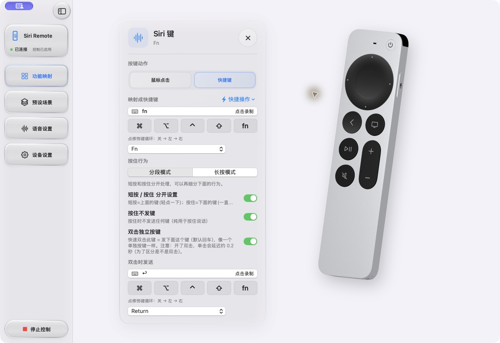
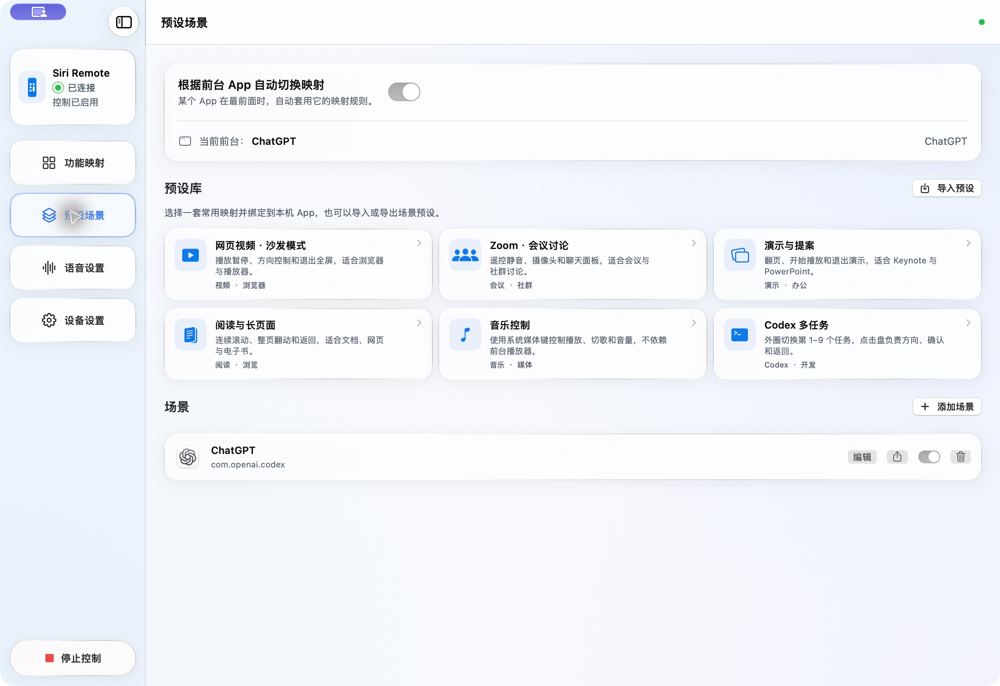
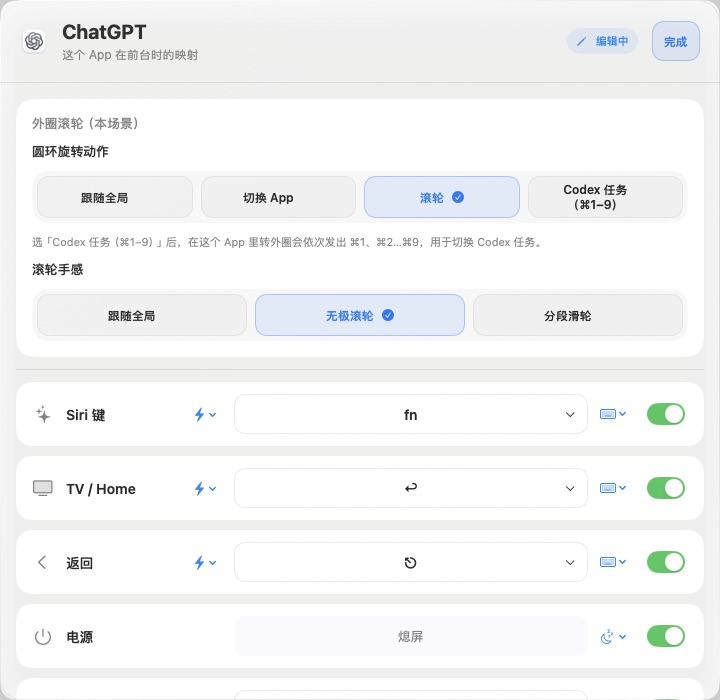
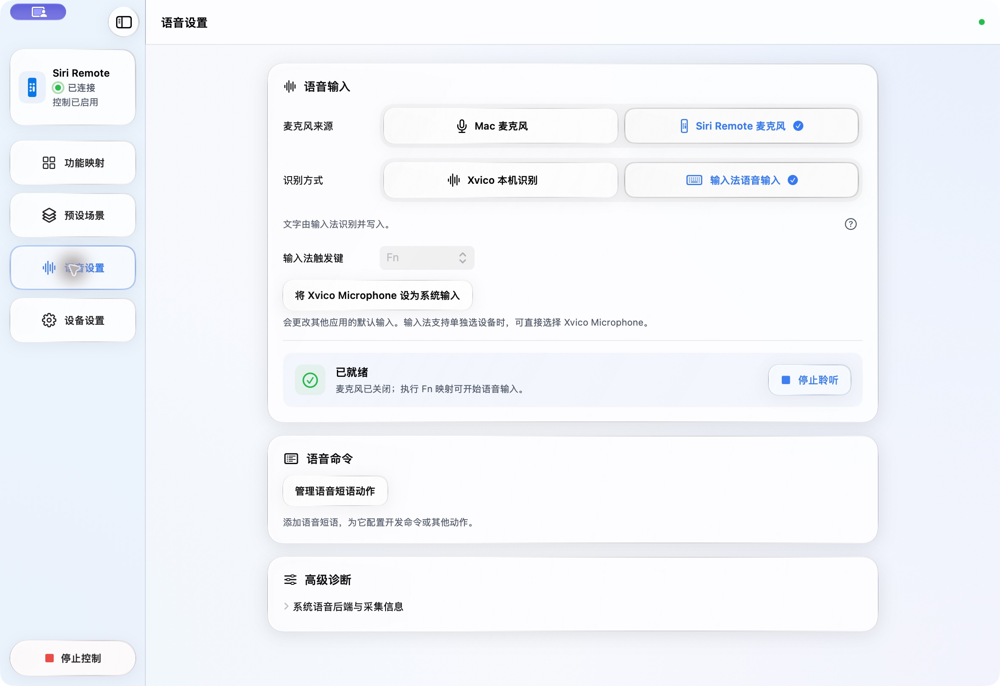
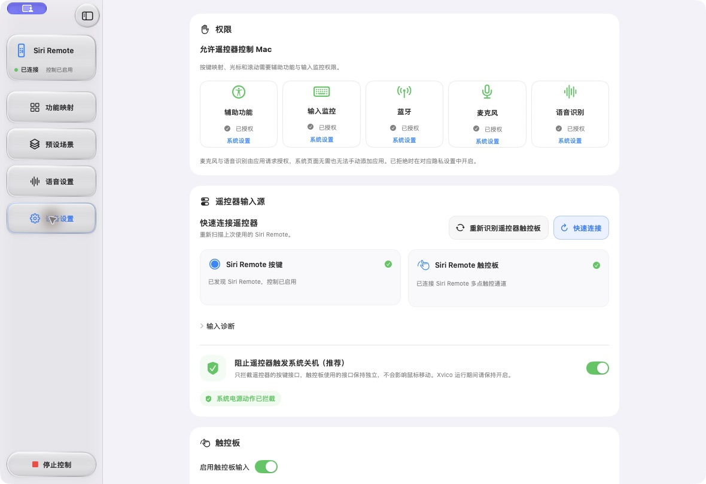

# Xvico

**掌心里的编程遥控器。**

[简体中文](README.md) · [English](README.en.md)

Xvico 将 Apple TV 的 Siri Remote 变成面向 macOS 的语音编程（Vibe Coding）遥控器，提供按 App 自定义映射、触控导航和语音输入。用遥控器移动指针、滚动对话和代码、切换应用或任务；需要说话时，可将 Mac 或遥控器麦克风的声音交给本机识别或输入法，用于 Codex 等编程工具中的文字输入。

**English overview:** Xvico turns Apple TV Siri Remote into a macOS controller for voice-driven coding (vibe coding), customizable per-app mappings, and touch navigation. Use voice input with coding tools such as Codex through on-device recognition or your preferred input method. [Read the English guide](README.en.md).

**beta.6 已更新玻璃界面、按键聚焦与模型渲染，并取消语音后台会话的固定时限。** [查看 beta.6 更新说明](docs/releases/1.0.0-beta.6.md) · [新版 UI 与功能详解](docs/updates/2026-10-16.md)。配置热重载、点击拖动和自动重连等此前能力继续保留。



## 下载安装

**[下载 Xvico 1.0.0-beta.6 · DMG](https://github.com/Xpacostack/Xvico/releases/download/v1.0.0-beta.6/Xvico-1.0.0-beta.6-macos-arm64.dmg)** · [ZIP 备用包](https://github.com/Xpacostack/Xvico/releases/download/v1.0.0-beta.6/Xvico-1.0.0-beta.6-macos-arm64.zip) · [版本说明与 SHA256](https://github.com/Xpacostack/Xvico/releases/tag/v1.0.0-beta.6)

- **适用：Apple Silicon（M1 及更新芯片），macOS 13 或更新版本。** 此包不支持 Intel Mac。
- 打开 DMG，将 **Xvico** 拖到 **Applications（应用程序）**，再从应用程序打开。
- 当前为**自签名、未经过 Apple 公证的测试版**。首次打开可能被 macOS 阻止；请先核对下载来源及校验值，再按 **系统设置 → 隐私与安全性** 的提示操作，无需关闭 Gatekeeper。GitHub 构建使用临时签名身份，后续测试版更新可能需要重新批准隐私权限及安装后台组件。
- 按键、触控与 Mac 麦克风可直接按下方说明配置。**遥控器麦克风另需自行取得官方 PacketLogger.app**，在 **语音设置 → 导入 Apple 语音运行时** 中导入后，再批准后端配置；公开安装包不附带 Apple 工具。导入不修改应用签名，也不会自动采音。

## 功能概览

| 功能             | 可以做什么                                                       |
| -------------- | ----------------------------------------------------------- |
| **3D 功能映射**    | 旋转查看遥控器，点击模型上的按键进入设置；支持单击、双击和按住行为。                          |
| **按 App 切换场景** | 从本机应用列表添加场景，编辑每个 App 的映射；启用后可根据前台应用自动切换，未匹配时使用全局映射。         |
| **指针与外圈控制**    | 触控移动指针；外圈可用于连续/分段滚动、切换 App，或发送 ⌘1–9 切换目标应用中的任务。             |
| **可编辑预设**      | 提供编程多任务、阅读、网页视频、演示、会议和音乐预设，支持绑定应用、继续编辑及导入导出。                |
| **两种语音路径**     | 使用 macOS 本机识别，或让已有输入法负责语音识别与文字写入。麦克风来源可选 Mac 或 Siri Remote。 |
| **系统虚拟麦克风**    | 可选安装 Xvico Microphone，让支持音频输入的其他应用使用遥控器声音。                  |
| **外观与语言**      | 浅色、深色和跟随系统外观；简体中文、英语、日语、法语界面。                               |

## 界面预览

以下为 2026-10-16 从当前源码构建的 Xvico 真实界面，展示新版 UI。点击图片可查看大图；截图中的映射是示例配置，可自行修改。

| 预设场景                 | 按应用编辑按键                       |
| -------------------- | ----------------------------- |
| [](docs/screenshots/scenes-zh.png) | [](docs/screenshots/scene-editor-zh.png) |
| 从常用预设开始，也可添加自己的应用场景。 | 在同一个编辑器里设置该 App 的外圈、按键动作和快捷键。 |

| 语音输入                         | 设备与权限                   |
| ---------------------------- | ----------------------- |
| [](docs/screenshots/voice-zh.png) | [](docs/screenshots/device-zh.png) |
| 选择麦克风来源及识别方式，按自己的输入法规则配置触发键。 | 查看权限与连接状态，调整遥控器输入及触控手感。 |

[中英文截图索引](docs/screenshots/README.md)

## 首次使用

1. 在 macOS 蓝牙设置中将 Siri Remote 与 Mac 配对，然后打开 Xvico。
2. 在 **设备设置** 中检查辅助功能与输入监控权限；使用蓝牙和语音功能时，按系统提示授予对应权限。
3. 在 **功能映射** 中点击 3D 遥控器按键，配置快捷键、鼠标点击、文本或其他动作。单击、双击和按住分别按需设置。
4. 在 **预设场景 → 添加场景** 中选择应用，或先选一套预设再绑定应用。编辑并启用场景，开启按前台 App 自动切换即可使用该应用的映射。
5. 需要语音时，在 **语音设置** 选择麦克风来源和识别方式，再完成下方的语音配置。

按键和触控无需启动音频采集。映射是否适用也取决于目标应用支持的快捷键；例如 ⌘1–9 预设需要目标应用提供相应任务切换快捷键。

## 语音输入

| 模式             | 识别与文字输出                                        | 使用前需要                                      |
| -------------- | ---------------------------------------------- | ------------------------------------------ |
| **Xvico 本机识别** | 通过 macOS Speech 的设备端识别生成文字，再交给 Xvico 的文字/动作流程。 | 麦克风和语音识别权限；系统及当前识别语言支持设备端识别，且本机语音资源可用。     |
| **输入法语音输入**    | 由输入法识别并将文字写入当前输入框。                             | 输入法本身支持语音输入；Xvico 中的输入法触发键及实际按键映射与输入法设置一致。 |

选择输入法模式后，可将希望使用的遥控器按键行为映射为输入法的触发键。例如输入法使用 Fn，则在 Xvico 选择 Fn，并将对应的单击、双击或按住行为配置为该键。识别开始、停止等操作遵循输入法自己的快捷键规则。

使用 Siri Remote 麦克风时：

- 需要下述 Apple 音频采集运行时，以及系统语音后端的管理员批准。
- 让输入法或目标应用选择 **Xvico Microphone**；若它不支持独立选择设备，可由用户在 Xvico 中将其设为系统输入。这会改变其他应用的默认输入。
- 可选择「保存后台授权」：亲自批准一次后台安装后，后续手动启动可复用授权，重开应用仍有效；安装和重开应用不会自动采音。也可保留「仅启动本次」的临时授权方式。组件更新或移除后台仍需管理员批准。
- 采集使用临时蓝牙诊断会话，可能涉及其他蓝牙设备的数据，首次保存授权或本次临时授权前会说明。使用 beta.6 并更新后台组件后，手动启动不设固定时长上限；主动停止、退出应用、系统睡眠或连接中断时结束采集并恢复临时诊断设置。遥控器麦克风仍按功能映射启停，后台待命不代表持续收音。
- **预设场景 → 恢复初始键位** 可恢复音量、静音、鼠标单击等初始映射，并暂停已有场景，保留其配置。支持撤销上次恢复；重新启用某个 App 场景后会继续根据前台应用自动切换。

本机识别请求设备端处理，不回退到在线识别服务。输入法模式下，识别服务、联网行为和隐私政策由所选输入法决定。异常退出后的处理见 [安全说明](SECURITY.md)。

## 从源码构建

需要 **macOS 13 或更新版本**、兼容的 Xcode/Swift 与 macOS SDK 工具链、Python 3，以及系统编译工具。当前遥控器按键与触控实现匹配 Apple 产品 ID `0x0315`；其他型号仍需验证。

所有 Swift 源码模块均在项目内，无父目录项目依赖。在项目根目录执行：

```sh
./build-app.sh
open dist/Xvico.app
```

脚本会构建主程序、音频工具与虚拟麦克风驱动，完成本地签名后输出 `dist/Xvico.app`。首次构建从 Xiph 官方站点下载固定版本 Opus，验证 SHA256 后编译；后续复用缓存。签名私钥位于用户 Application Support，不进入仓库；已有安装继续使用原固定签名身份。

### Apple 音频运行时

Mac 麦克风使用系统接口。Siri Remote 音频采集另外需要合法取得的、Apple 签名的 PacketLogger/PacketDecoder 运行时。**这些 Apple 二进制不包含在 Git 源码或公开安装包中。** 已安装应用的用户可在 **语音设置 → 导入 Apple 语音运行时** 中选择官方 `PacketLogger.app`，无需重新构建。导入器会验证 Apple 签名，将所需组件保存在用户的 Application Support 中；后台安装会再次验证并复制到受保护的系统目录。

取得官方工具后，将具有 `Resources/packetlogger` 和 `Frameworks/PacketDecoder.framework` 布局的运行时目录、`.app` 或其 `Contents` 目录加入本机构建：

```sh
python3 scripts/prepare-packetlogger.py --source '/path/to/PacketLogger.app'
./build-app.sh
```

导入脚本会检查实际文件布局和 Apple 签名；工具版本的目录布局必须匹配。官方工具见 [Apple 下载入口](https://developer.apple.com/download/all/)。缺少该运行时仍可构建应用，但 Siri Remote 音频采集不可用。

构建和软件测试不会授予系统权限、安装系统驱动或启动录音。虚拟麦克风安装与采集由用户另外启动。本地开发签名不等于面向公开发行的 Developer ID 签名与公证；见 [发布流程](docs/RELEASE.md)。

## 开发与验证

```sh
python3 scripts/build-opus.py
swift test
python3 scripts/audit-localization.py --check
python3 scripts/check-release.py
```

软件测试覆盖映射、场景切换、输入方向、语音路由、异常输入等逻辑。真实遥控器重连、连续语音会话及不同输入法仍需硬件验收。

- [架构说明](docs/ARCHITECTURE.md)
- [贡献说明](CONTRIBUTING.md)
- [安全问题反馈](SECURITY.md)

## 授权与联系

**个人和企业内部使用免费；对外售卖、付费分发或提供商业 Xvico 服务，需要项目权利人的书面授权。** 使用 Xvico 编写商业代码或完成日常工作，不会改变成果的权利归属。

项目自己的可授权材料采用 [Xvico Source Available License 1.0](LICENSE)，属于源码可用许可，不是 OSI 开源许可证。第三方 GPL、Opus 等组件继续适用各自许可证，根商业条款不替代这些权利。详见 [商业授权说明](COMMERCIAL_LICENSE.md) 和 [第三方许可清单](THIRD_PARTY_NOTICES.md)。

使用问题、功能建议与商业授权申请，可通过应用 **设备设置 → 联系开发者** 中的微信二维码，或 Telegram [@heitonk](https://t.me/heitonk) 联系维护者。

语音启停、睡眠唤醒与连接恢复行为及硬件验收步骤，见[语音生命周期说明](docs/voice-lifecycle.md)。连续语音及断连恢复已实测；真实睡眠唤醒仍待验收。
